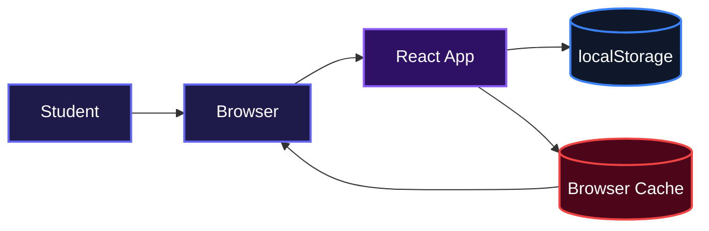
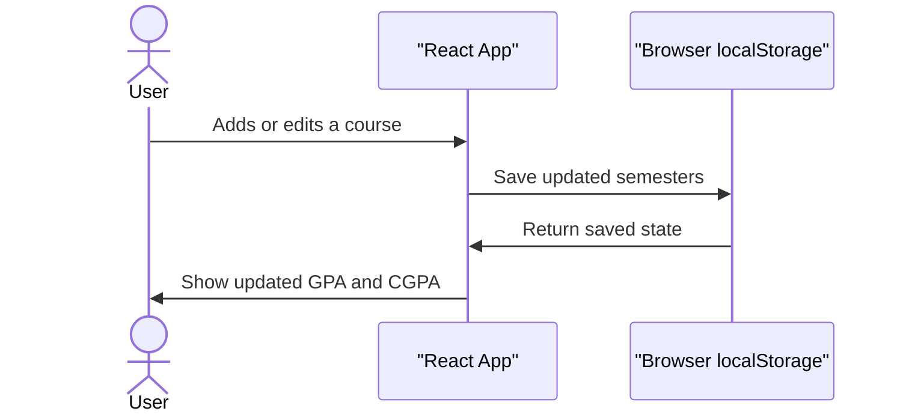

# CGPA Calculator

[](https://num-cgp-acalculator.vercel.app/)

## Overview

This project helps students keep tabs on their academic standing across multiple semesters. Instead of wrestling with spreadsheets, users add their courses, pick grades and credits, and instantly see both semester GPA and cumulative CGPA. A built-in chart visualizes progress over time, making it easy to spot trends at a glance.

## System Architecture



## Features

- **Dynamic Semester Management**: Add, switch between, and delete semesters to match any academic timeline.
- **Course Tracking**: Enter course titles, select grades from A to F, and input credit units for each course.
- **Real-Time Calculations**: Semester GPA and cumulative CGPA update instantly as you type.
- **Progress Visualization**: A line chart shows GPA per semester and CGPA trend over time.
- **Persistent Storage**: Your data is saved automatically in the browser, so nothing is lost on refresh.
- **Offline Ready**: A registered service worker caches assets for faster reloads and offline access.

### CGPA Calculation Flow

```mermaid
flowchart LR
  User["User"]
  Semester["Manage Semesters"]
  Course["Enter Course Details"]
  Calculate["Compute GPA & CGPA"]
  Display["Update Dashboard & Chart"]

  User --> Semester
  Semester --> Course
  Course --> Calculate
  Calculate --> Display

  style User fill:#1e1b4b,stroke:#6366f1,stroke-width:2px,color:#fff
  style Semester fill:#2e1065,stroke:#8b5cf6,stroke-width:2px,color:#fff
  style Course fill:#2e1065,stroke:#8b5cf6,stroke-width:2px,color:#fff
  style Calculate fill:#2e1065,stroke:#8b5cf6,stroke-width:2px,color:#fff
  style Display fill:#1e1b4b,stroke:#6366f1,stroke-width:2px,color:#fff
```



### Data Persistence Flow



## Installation

1. Clone the repository:

```bash
git clone https://github.com/NumCodes/NumCGPAcalculator.git
```

2. Move into the project folder:

```bash
cd NumCGPAcalculator
```

3. Install the dependencies:

```bash
npm install
```

4. Start the development server:

```bash
npm start
```

The app will open at `http://localhost:3000`.

## Usage

1. Open the app and click **Add Semester** to create a new semester.
2. Inside the active semester, click **Add Course** to add a course row.
3. Fill in the course name, select a grade from the dropdown, and enter the credit units.
4. Watch the semester GPA update immediately and the cumulative CGPA update in the progress dial.
5. Click **View Analysis** to scroll down and see the GPA and CGPA trend chart.
6. Your data is saved automatically, so you can close the tab and come back later.

## Technologies Used

| Technology | Description |
|---|---|
| [React](https://react.dev/) | UI library for building the calculator interface |
| [Chart.js](https://www.chartjs.org/) | Charting library for the GPA/CGPA visualization |
| [react-chartjs-2](https://react-chartjs-2.js.org/) | React wrapper for Chart.js |
| [Tailwind CSS](https://tailwindcss.com/) | Utility-first CSS framework for styling |
| [react-circular-progressbar](https://www.npmjs.com/package/react-circular-progressbar) | Semicircle progress indicator for the CGPA dial |
| [react-icons](https://react-icons.github.io/react-icons/) | Icon library used across the UI |
| [Create React App](https://create-react-app.dev/) | Toolchain used to bootstrap the project |
| [Workbox](https://developer.chrome.com/docs/workbox/) | Service worker library powering offline support |

## Contributing

Contributions are welcome. If you find a bug or have an idea for an improvement, feel free to open an issue or submit a pull request.

## Author

Built by **Num Codes** (Ugochukwu Nweze)

- LinkedIn: [https://linkedin.com/in/ugochukwu-nweze-08812a2b8](https://linkedin.com/in/ugochukwu-nweze-08812a2b8)
- X (Twitter): [https://x.com/CodesNum80638](https://x.com/CodesNum80638)
- GitHub: [https://github.com/numcodes](https://github.com/numcodes)

## Badges

[](https://react.dev/)
[](https://developer.mozilla.org/en-US/docs/Web/JavaScript)
[](https://tailwindcss.com/)
[](https://www.chartjs.org/)
[](https://vercel.com/)
